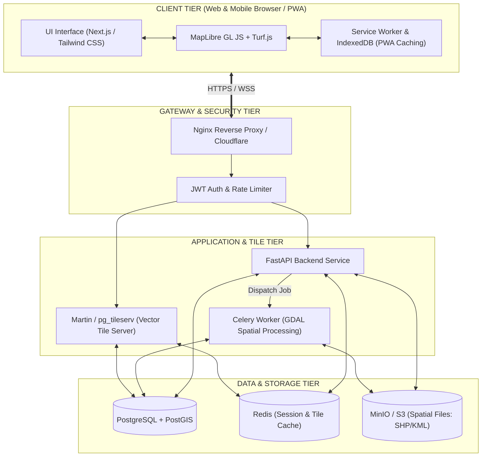
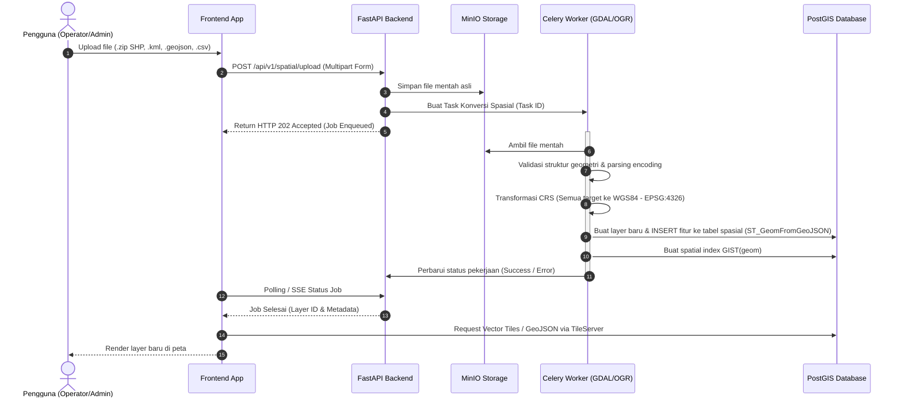
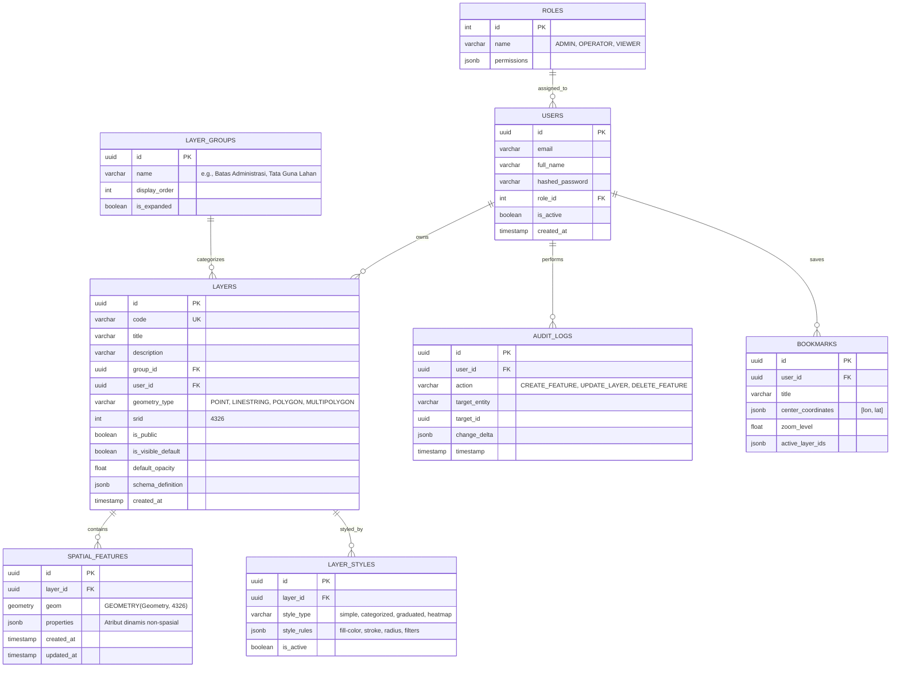
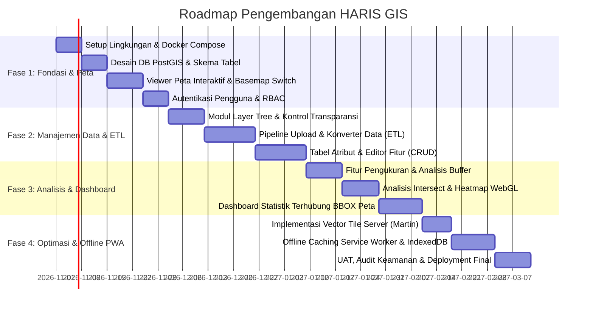

# DOKUMEN RANCANGAN SISTEM & ARSITEKTUR
# HARIS GIS (High-Availability & Responsive Information System - GIS)

---

## 1. PENDAHULUAN & RINGKASAN EKSEKUTIF

### 1.1 Deskripsi Produk
**HARIS GIS** adalah platform Sistem Informasi Geografis (SIG/GIS) modern berbasis web dan mobile-responsive yang dirancang untuk kebutuhan pemetaan interaktif, manajemen data spasial multi-format, analisis keruangan terpadu, dan visualisasi statistik analitik. 

Platform ini dirancang dengan arsitektur modular, scalable, dan mengadopsi standar internasional geospasial (**OGC - Open Geospatial Consortium**) serta mendukung ekosistem Cloud-Native GIS.

### 1.2 Tujuan Utama Sistem
1. Menyediakan visualisasi peta berkinerja tinggi yang responsif pada perangkat desktop, tablet, dan ponsel.
2. Memfasilitasi pengelolaan layer spasial yang dinamis dengan pengelompokan hierarkis dan penyesuaian visualisasi (simbologi, transparansi).
3. Menyediakan ETL (Extract-Transform-Load) otomatis untuk format spasial populer (Shapefile, GeoJSON, KML, CSV berkoordinat).
4. Menyediakan alat analisis spasial dasar secara instan di sisi klien maupun pemrosesan presisi di sisi server.
5. Mendukung tata kelola data melalui Role-Based Access Control (RBAC) dan audit logging.
6. Menyediakan kapabilitas offline caching untuk skenario penggunaan di area minim koneksi internet (low-bandwidth/offline-first).

---

## 2. PEMILIHAN TEKNOLOGI (TECH STACK) & ANALISIS TRADE-OFF

### 2.1 Peta Evaluasi Mesin Peta (Map Engine)

| Kriteria | Leaflet | MapLibre GL JS | OpenLayers | Mapbox GL JS | Google Maps API |
| :--- | :--- | :--- | :--- | :--- | :--- |
| **Tipe Rendering** | DOM/Canvas (Raster & SVG) | WebGL (Vector & Raster Tiles) | Canvas/WebGL | WebGL (Vector) | Proprietary WebGL/Raster |
| **Performa Data Masif** | Sedang (<5.000 titik mulus) | Sangat Tinggi (>100.000 titik 60 FPS) | Tinggi (~50.000 titik) | Sangat Tinggi | Tinggi |
| **Styling & 3D** | Terbatas (2D murni) | Tinggi (Dukungan 3D terrain, rotasi, pitch) | Tinggi | Sangat Tinggi | Cukup |
| **Lisensi & Biaya** | Open Source (BSD-2) | Open Source (BSD-3, Bebas biaya) | Open Source (BSD-2) | Komersial berbayar pasca-tier gratis | Pay-per-use, Mahal |
| **Offline Vector Tiles** | Rumit | Sangat Mudah (MVT/Protobuf) | Cukup | Sangat Mudah | Terbatas/Melanggar TOS |
| **Rekomendasi** | ✅ Alternatif UI Ringan | 🏆 **PILIHAN UTAMA (Rekomendasi)** | Bagus untuk OGC advance | Opsi Berbayar | Kurang Cocok untuk GIS Custom |

> [!TIP]
> **Keputusan Arsitektur**: Menggunakan **MapLibre GL JS** sebagai engine utama karena performa rendering WebGL yang sangat cepat, kemampuan memproses Vector Tiles (.mvt / .pbf), bebas royalti (open source fork dari Mapbox v1), dan kompatibilitas offline yang prima. Untuk fallback perangkat lawas atau modul ringan, abstraksi Leaflet dapat disediakan.

### 2.2 Arsitektur Stack Pilihan

| Layer | Teknologi Rekomendasi | Alternatif | Justifikasi |
| :--- | :--- | :--- | :--- |
| **Frontend Web/PWA** | **React / Next.js + TypeScript + Tailwind CSS** | Vue 3 / Nuxt 3 | Ekosistem komponen luas, SSR/SSG untuk landing page & dashboard, static SPA capability untuk PWA. |
| **State Management** | **Zustand + TanStack Query (React Query)** | Redux Toolkit | Ringan, reaktif untuk state layer peta, caching respons API spasial secara efisien. |
| **Client-Side Spatial** | **Turf.js** | JSTS | Standar industri analisis spasial GeoJSON di browser (buffer, intersect, convex hull). |
| **Backend Framework** | **FastAPI (Python 3.11+)** | Node.js (NestJS) | Ekosistem Python tak tertandingi untuk manipulasi data spasial (GeoPandas, Shapely, PyProj, Fiona, GDAL). |
| **Basis Data Spasial** | **PostgreSQL 16 + PostGIS 3.4** | SpatiaLite / MySQL 8 | Standar emas industri GIS. Indeks spasial R-Tree (GIST/SP-GIST), ratusan fungsi `ST_*`. |
| **Vector Tile Engine** | **Martin / pg_tileserv** | GeoServer | Tile server ultra-cepat berbasis Rust/Go yang menghasilkan Vector Tiles (MVT) langsung dari tabel PostGIS. |
| **File Storage** | **MinIO (S3-Compatible)** | AWS S3 / Local Disk | Penyimpanan aman file mentah Shapefile, KML, CSV yang diupload pengguna. |
| **Task Queue & Cache** | **Redis + Celery / RQ** | BullMQ | Pemrosesan asinkron untuk file Shapefile berukuran besar (>50 MB) agar API tidak timeout. |
| **Containerization** | **Docker & Docker Compose** | Kubernetes | Kemudahan deployment dan standarisasi dependensi sistem (GDAL/GEOS/PROJ). |

---

## 3. ARSITEKTUR SISTEM & DIAGRAM ALIR

### 3.1 Diagram Arsitektur Tingkat Tinggi (High-Level Architecture)



### 3.2 Alur Upload dan Konversi Data Spasial (ETL Pipeline)



---

## 4. PERANCANGAN BASIS DATA SPASIAL (POSTGIS)

### 4.1 Diagram Entitas Hubungan (ERD)



### 4.2 Skrip DDL Basis Data (PostgreSQL & PostGIS)

```sql
-- 1. Inisialisasi Ekstensi Spasial dan UUID
CREATE EXTENSION IF NOT EXISTS "uuid-ossp";
CREATE EXTENSION IF NOT EXISTS "postgis";
CREATE EXTENSION IF NOT EXISTS "postgis_topology";

-- 2. Master Peran Pengguna (RBAC)
CREATE TABLE roles (
    id SERIAL PRIMARY KEY,
    name VARCHAR(50) UNIQUE NOT NULL,
    description TEXT,
    permissions JSONB NOT NULL DEFAULT '{}'
);

INSERT INTO roles (name, description, permissions) VALUES
('ADMIN', 'Akses administrator penuh', '{"all": true}'),
('OPERATOR', 'Dapat mengunggah data, CRUD fitur & layer', '{"layers:create": true, "layers:edit": true, "features:write": true}'),
('VIEWER', 'Hanya melihat peta, query, dan analisis baca', '{"layers:read": true, "features:read": true}');

-- 3. Tabel Pengguna
CREATE TABLE users (
    id UUID PRIMARY KEY DEFAULT uuid_generate_v4(),
    email VARCHAR(255) UNIQUE NOT NULL,
    full_name VARCHAR(150) NOT NULL,
    hashed_password VARCHAR(255) NOT NULL,
    role_id INT NOT NULL REFERENCES roles(id),
    is_active BOOLEAN NOT NULL DEFAULT TRUE,
    created_at TIMESTAMP WITH TIME ZONE DEFAULT CURRENT_TIMESTAMP,
    updated_at TIMESTAMP WITH TIME ZONE DEFAULT CURRENT_TIMESTAMP
);

-- 4. Grup / Kategori Layer
CREATE TABLE layer_groups (
    id UUID PRIMARY KEY DEFAULT uuid_generate_v4(),
    name VARCHAR(100) NOT NULL,
    display_order INT NOT NULL DEFAULT 0,
    created_at TIMESTAMP WITH TIME ZONE DEFAULT CURRENT_TIMESTAMP
);

-- 5. Metadata Layer
CREATE TABLE layers (
    id UUID PRIMARY KEY DEFAULT uuid_generate_v4(),
    code VARCHAR(100) UNIQUE NOT NULL,
    title VARCHAR(200) NOT NULL,
    description TEXT,
    group_id UUID REFERENCES layer_groups(id) ON DELETE SET NULL,
    user_id UUID REFERENCES users(id) ON DELETE SET NULL,
    geometry_type VARCHAR(50) NOT NULL, -- Point, LineString, Polygon, MultiPolygon
    srid INT NOT NULL DEFAULT 4326,
    is_public BOOLEAN NOT NULL DEFAULT FALSE,
    is_visible_default BOOLEAN NOT NULL DEFAULT TRUE,
    default_opacity FLOAT NOT NULL DEFAULT 1.0 CHECK (default_opacity BETWEEN 0.0 AND 1.0),
    schema_definition JSONB NOT NULL DEFAULT '[]', -- Skema atribut [{name: "nama", type: "string"}]
    created_at TIMESTAMP WITH TIME ZONE DEFAULT CURRENT_TIMESTAMP
);

-- 6. Tabel Fitur Spasial Terpadu
CREATE TABLE spatial_features (
    id UUID PRIMARY KEY DEFAULT uuid_generate_v4(),
    layer_id UUID NOT NULL REFERENCES layers(id) ON DELETE CASCADE,
    geom GEOMETRY(Geometry, 4326) NOT NULL,
    properties JSONB NOT NULL DEFAULT '{}',
    created_by UUID REFERENCES users(id),
    created_at TIMESTAMP WITH TIME ZONE DEFAULT CURRENT_TIMESTAMP,
    updated_at TIMESTAMP WITH TIME ZONE DEFAULT CURRENT_TIMESTAMP
);

-- INDEKS SPASIAL & JSONB (KUNCI PERFORMA TINGGI)
CREATE INDEX idx_spatial_features_geom ON spatial_features USING GIST (geom);
CREATE INDEX idx_spatial_features_layer_id ON spatial_features (layer_id);
CREATE INDEX idx_spatial_features_props ON spatial_features USING GIN (properties);

-- 7. Aturan Styling Simbologi
CREATE TABLE layer_styles (
    id UUID PRIMARY KEY DEFAULT uuid_generate_v4(),
    layer_id UUID NOT NULL REFERENCES layers(id) ON DELETE CASCADE,
    style_type VARCHAR(50) NOT NULL DEFAULT 'simple', -- simple, categorized, graduated, heatmap
    style_rules JSONB NOT NULL,
    is_active BOOLEAN NOT NULL DEFAULT TRUE,
    created_at TIMESTAMP WITH TIME ZONE DEFAULT CURRENT_TIMESTAMP
);
```

---

## 5. SPESIFIKASI MODUL & FITUR UTAMA

### 5.1 Visualisasi Peta Interaktif
1. **Basemap Switcher**:
   - OpenStreetMap Standard (Tile Gratis).
   - Google Maps (Roadmap, Satellite, Hybrid) via Google Maps Tile API atau Mapbox Satellite.
   - Positron / Dark Matter (CartoDB) untuk visualisasi analitik tematik kontras tinggi.
   - Peta Rupa Bumi Indonesia (BIG) via WMS/WMTS jika tersedia.
2. **Kontrol Navigasi**:
   - Zoom In/Out, Reset North (Heading), Pitch 3D Control (0° - 60°), Skala Peta Dinamis (Metrik & Imperial).
   - Penampil Posisi Kursor (Koordinat Geografis Lat/Lon WGS84 & Proyeksi UTM Zone aktual).
   - Geolocation (Tombol "Lokasi Saya" dengan akurasi GPS browser/mobile).

### 5.2 Manajemen Layer (Layer Tree & Controller)
- **Hierarchical Layer Grouping**: Pengelompokan layer berbasis folder/kategori (contoh: *Batas Wilayah*, *Infrastruktur Jalan*, *Fasilitas Kesehatan*, *Bencana Alam*).
- **Visibilitas & Urutan Rendering**:
  - Checkbox toggle On/Off per layer dan per grup.
  - Drag-and-drop layer reordering (mengatur urutan `z-index` tampilan).
- **Pengaturan Transparansi (Opacity Slider)**: Slider 0% hingga 100% per layer secara real-time tanpa refresh peta.
- **Simbologi & Legenda Dinamis**:
  - Warna isian (Fill Color), Garis tepi (Stroke Color & Width).
  - Tipe Point: Circle, Square, Custom SVG Icon, Proportional Marker.
  - Heatmap visualizer: Pengaturan blur radius, max weight, gradient color stops.

### 5.3 Upload & Konversi Data Spasial
Mendukung 4 format utama dengan konverter otomatis:
1. **Shapefile (`.zip`)**:
   - Format wajib: Berisi file `.shp`, `.shx`, `.dbf`, dan `.prj`.
   - Diproses menggunakan library `GDAL/OGR` / `Fiona` / `GeoPandas`.
   - Sistem membaca `.prj` untuk mendeteksi koordinat asal dan mengonversinya secara otomatis ke `EPSG:4326`.
2. **GeoJSON (`.geojson`, `.json`)**:
   - Validasi struktur GeoJSON RFC 7946 (FeatureCollection).
   - Deteksi kolom atribut otomatis.
3. **KML / KMZ (`.kml`, `.kmz`)**:
   - Ekstraksi placemark, polygon coordinates, dan ExtendedData.
4. **CSV Koordinat (`.csv`)**:
   - Wizard pemilih kolom: Pengguna memilih kolom mana yang merupakan `Latitude / Y` dan `Longitude / X`.
   - Alternatif: Kolom berformat `WKT` (*Well-Known Text* seperti `POINT(106.8 -6.2)`).

### 5.4 Analisis Spasial Dasar
| Fitur Analisis | Eksekusi | Deskripsi Teknis |
| :--- | :--- | :--- |
| **Buffer Analysis** | Klien & Server | Membuat area penyangga radius tertentu ($R$ meter/km) dari titik/garis/poligon. Sisi klien menggunakan `turf.buffer()` untuk preview instan; sisi server menggunakan `ST_Buffer(geom::geography, distance)` untuk pembuatan layer analisis permanen. |
| **Spatial Intersect** | Server-Side | Menghitung perpotongan dua layer spasial menggunakan `ST_Intersection(a.geom, b.geom)`. Menghasilkan poligon tumpang-tindih (contoh: tutupan hutan vs konsesi tambang). |
| **Measure Tool** | Client-Side | - Pengukur jarak geodesik multi-titik (`turf.length()`).<br>- Pengukur luas area poligon (`turf.area()`) dalam $m^2$ atau Hektar.<br>- Snapping pointer interaktif ke vertex terdekat. |
| **Heatmap Density** | WebGL Shader | Menghitung kerapatan spasial titik (point density) berbobot atribut numerik secara real-time via shader GPU MapLibre GL. |

### 5.5 Pencarian Lokasi, Koordinat & Geocoding
1. **Pencarian Alamat & POI (Forward Geocoding)**:
   - Terintegrasi dengan OpenStreetMap Nominatim atau Photon API dengan autocomplete input debounce (300ms).
2. **Pencarian Koordinat Presisi**:
   - Format Decimal Degrees: `-6.2088, 106.8456`.
   - Format Degrees Minutes Seconds (DMS): `6°12'31.7"S 106°50'44.2"E`.
   - Format UTM (Zone 48S, 48N, 49S, 50S, dll).
3. **Reverse Geocoding**:
   - Fitur "Klik di Peta": Menampilkan popup alamat lengkap dan elevasi perkiraan di titik klik.

### 5.6 Manajemen Data Atribut (CRUD Spasial & Non-Spasial)
- **Tabel Atribut Interaktif (Floating / Bottom Drawer)**:
  - Tampilan grid data dengan sorting, filtering berbasis teks/angka, dan pagination.
  - Opsi *"Filter by Map Extent"*: Hanya menampilkan data fitur yang terlihat dalam viewport peta saat ini.
- **Editor Geometri (Drawing Tools)**:
  - Tambah, geser vertex, hapus vertex (Point, Polyline, Polygon, Rectangle).
- **Formulir Atribut**:
  - Modal form dinamis untuk mengubah nilai properti atribut non-spasial sesuai schema layer.
- **Ekspor Data**:
  - Unduh hasil filter ke GeoJSON, Shapefile (.zip), CSV, atau Excel (.xlsx).

### 5.7 Autentikasi & Matriks Hak Akses (RBAC)

| Kemampuan / Fitur | Admin | Operator | Viewer | Publik (Guest) |
| :--- | :---: | :---: | :---: | :---: |
| Lihat Peta Publik & Layer Terbuka | ✅ | ✅ | ✅ | ✅ |
| Pengukuran (Jarak & Luas) | ✅ | ✅ | ✅ | ✅ |
| Pencarian & Geocoding | ✅ | ✅ | ✅ | ✅ |
| Lihat Layer Privat / Internal | ✅ | ✅ | ✅ | ❌ |
| Ekspor Data Spasial | ✅ | ✅ | ⚠️ Terbatas | ❌ |
| Analisis Spasial (Buffer & Intersect) | ✅ | ✅ | ✅ | ❌ |
| Upload & Konversi Data Spasial | ✅ | ✅ | ❌ | ❌ |
| Tambah / Edit / Hapus Fitur (CRUD) | ✅ | ✅ | ❌ | ❌ |
| Kelola Manajemen Layer & Grup | ✅ | ⚠️ Layer Sendiri | ❌ | ❌ |
| Manajemen Pengguna & Hak Akses | ✅ | ❌ | ❌ | ❌ |
| Audit Trail & Log Aktivitas | ✅ | ❌ | ❌ | ❌ |

### 5.8 Dashboard Statistik Berbasis Peta
- **Reaktif terhadap Peta (Extent-Bound Analytics)**:
  - Saat pengguna melakukan pan/zoom, grafik dan indikator statistik otomatis memperbarui nilainya sesuai fitur yang masuk dalam Bounding Box (`BBOX`).
- **Komponen Dashboard**:
  - **KPI Cards**: Total Fitur, Total Luasan Area (Ha), Total Panjang Jaringan (Km).
  - **Chart Distribusi Kategori**: Bar chart / Doughnut chart sebaran fitur per kategori.
  - **Timeline Chart**: Distribusi data berdasarkan tanggal input atau histori perubahan.

### 5.9 Fitur Offline Caching (Mobile & PWA)
- **Service Worker (Workbox)**:
  - Cache First untuk asset statis aplikasi (HTML, CSS, JS, Icon).
  - Stale-While-Revalidate untuk basemap tiles raster standar.
- **IndexedDB Storage (Dexie.js)**:
  - Menyimpan data GeoJSON layer kerja yang dipilih pengguna untuk akses offline.
  - Menyimpan fitur yang baru digambar/diedit saat offline (*Draft Submissions*).
- **Background Synchronization**:
  - Saat koneksi internet kembali pulih (`online` event), antrean perubahan di IndexedDB otomatis dikirimkan ke server melalui sinkronisasi latar belakang.

---

## 6. DESAIN ANTARMUKA PENGGUNA (UI/UX)

### 6.1 Layout Desktop (Split-Panel GIS Workspace)

```
+----------------------------------------------------------------------------------------------------+
| [HARIS GIS LOGO] | [Cari Alamat / Koordinat...    ] | [Basemap v] | [Analisis v] | [User: Admin v] |
+------------------+---------------------------------------------------------------+-----------------+
| [DAFTAR LAYER]   | [Toolbar: Pointer | Titik | Garis | Poligon | Ukur | Buffer ]    | [INFO FITUR]    |
| + [Kategori A]   +---------------------------------------------------------------+ - Nama: Stasiun |
|   [x] Jalan      |                                                               | - Tipe: Point   |
|   [ ] Bangunan   |                                                               | - Koordinat:    |
| + [Kategori B]   |                         MAP CANVAS                            |   106.8, -6.2   |
|   [x] Batas Adm  |                   (MapLibre GL Rendering)                     |                 |
|                  |                                                               | [Edit] [Hapus]  |
| [Transparansi]   |                                                               |                 |
| [===========] 80%|                                                               | [TUTUP PANEL]   |
|                  |                                                               +-----------------+
| [+ Upload Data]  |                                                               | [LEGENDA PETA]  |
|                  |                                                               | [*] RS Umum     |
| [Buka Statistik] | [Skala: 1:50.000] [Lat: -6.2088 Lon: 106.8456]                | [=] Jalan Arteri|
+------------------+---------------------------------------------------------------+-----------------+
| [v TABEL DATA ATRIBUT: Layer Batas Administrasi (Menampilkan 120 dari 120 fitur)        [Export v] |
| ID   | Nama Kecamatan  | Luas (Ha) | Jumlah Penduduk | Status     | Aksi                           |
| 001  | Gambir          | 760       | 95.000          | Terverifikasi | [Zoom] [Edit] [Hapus]       |
| 002  | Menteng         | 650       | 88.000          | Terverifikasi | [Zoom] [Edit] [Hapus]       |
+----------------------------------------------------------------------------------------------------+
```

### 6.2 Layout Mobile (Responsive PWA View)

```
+-----------------------------------+
| [=] HARIS GIS      [Q Cari] [*GPS]|
+-----------------------------------+
|                                   |
|                                   |
|            MAP VIEW               |
|          (Penuh Layar)            |
|                                   |
|              [+] [Zoom Controls]  |
|              [-]                  |
|                                   |
|      (o) Lokasi Saya              |
|                                   |
|                      [Fab: Layer] |
|                      [Fab: Draw ] |
+-----------------------------------+
| ^ PANEL BAWAH (BOTTOM SHEET)      |
| === (Geser ke atas untuk detail)  |
| Rincian Titik Terpilih:           |
| Puskesmas Kecamatan Menteng       |
| Jarak: 450 meter dari Anda        |
| [Arahkan Rute] [Lihat Atribut]    |
+-----------------------------------+
```

---

## 7. SPESIFIKASI API RESTFUL (BACKEND ENDPOINTS)

### 7.1 Autentikasi & Akun
- `POST /api/v1/auth/register` - Registrasi pengguna baru.
- `POST /api/v1/auth/login` - Autentikasi kredensial, menghasilkan JWT Access & Refresh Token.
- `GET /api/v1/auth/me` - Mengambil profil dan izin pengguna saat ini.

### 7.2 Manajemen Layer & Grup
- `GET /api/v1/layers` - Mengambil daftar seluruh layer aktif sesuai hak akses.
- `POST /api/v1/layers` - Membuat metadata layer baru.
- `GET /api/v1/layers/{id}` - Detail informasi layer dan skema atribut.
- `PATCH /api/v1/layers/{id}` - Memperbarui judul, transparansi default, status publikasi.
- `DELETE /api/v1/layers/{id}` - Menghapus layer beserta seluruh fiturnya.
- `GET /api/v1/layer-groups` - Mengambil struktur pohon grup layer.

### 7.3 Data Spasial & Fitur
- `GET /api/v1/layers/{id}/features` - Mengambil data GeoJSON dengan parameter query:
  - `bbox=minX,minY,maxX,maxY` (filter bounding box).
  - `page`, `page_size`, `search`, `filter_props`.
- `POST /api/v1/layers/{id}/features` - Menambahkan fitur spasial baru.
- `PUT /api/v1/features/{feature_id}` - Memperbarui geometri dan atribut fitur.
- `DELETE /api/v1/features/{feature_id}` - Menghapus fitur tertentu.

### 7.4 Vector Tiles (MVT Server)
- `GET /api/v1/tiles/{layer_id}/{z}/{x}/{y}.pbf` - Mengambil Vector Tile terkompresi dari PostGIS via `ST_AsMVT`.

### 7.5 Upload & Pemrosesan ETL Spasial
- `POST /api/v1/spatial/upload` - Mengunggah file (.zip Shapefile, .kml, .geojson, .csv).
- `GET /api/v1/spatial/tasks/{task_id}` - Memeriksa status proses konversi asinkron.
- `POST /api/v1/spatial/export` - Mengekspor layer ke format yang dipilih (SHP, KML, GeoJSON, CSV).

### 7.6 Analisis Spasial
- `POST /api/v1/analysis/buffer` - Menghasilkan geometri buffer dari layer sumber.
- `POST /api/v1/analysis/intersect` - Menghitung irisan antara dua layer.
- `GET /api/v1/analysis/stats` - Agregasi data spasial (hitung fitur, jumlah luasan) berdasarkan BBOX atau poligon administratif.

### 7.7 Geocoding & Lokasi
- `GET /api/v1/geo/search?q={keyword}` - Forward geocoding.
- `GET /api/v1/geo/reverse?lat={lat}&lon={lon}` - Reverse geocoding.

---

## 8. KEAMANAN, PERFORMA & SKALABILITAS

### 8.1 Keamanan Sistem
1. **Sanitasi Geometri & Pencegahan Injeksi SQL Spasial**:
   - Seluruh query spasial dinamis wajib menggunakan parameterized queries / ORM (GeoAlchemy2).
   - Validasi WKT / GeoJSON dengan parser library yang ketat sebelum dimasukkan ke `ST_GeomFromText`.
2. **Validasi File Unggahan**:
   - Pengecekan Magic Bytes file (mencegah file berbahaya berekstensi samaran).
   - Batas maksimum ukuran upload (contoh: 50MB per Shapefile ZIP).
   - Sanitasi nama layer dan pencegahan Path Traversal pada ekstraksi ZIP.
3. **CORS & Rate Limiting**:
   - Kebijakan CORS ketat pada domain klien.
   - Rate limiting pada endpoint publik seperti Geocoding dan Vector Tiles untuk mencegah scraping masif.

### 8.2 Optimasi Performa Spasial
1. **Spatial Indexing**: Penggunaan indeks `GIST` pada semua kolom geometri untuk query spasial bernilai ribuan kali lebih cepat daripada scan linier.
2. **Dynamic Generalization (Douglas-Peucker)**:
   - Pada zoom level rendah (tampilan jauh), gunakan `ST_Simplify(geom, tolerance)` atau letakkan beban pada Vector Tile Server (`Martin`) agar ukuran data transfer tetap kecil (<100KB per tile).
3. **HTTP Caching**: Header `Cache-Control` dengan nilai `max-age=86400` untuk Vector Tiles pada layer yang bersifat statis (seperti batas administrasi).

---

## 9. RENCANA IMPLEMENTASI & ROADMAP PENGEMBANGAN



---

## 10. REKOMENDASI TAHAP SELANJUTNYA
1. **Penyusunan Lingkungan Kerja (Dev Environment)**: Menyediakan file `docker-compose.yml` untuk PostgreSQL + PostGIS, Redis, dan MinIO.
2. **Scaffolding Proyek**:
   - Backend: Inisialisasi FastAPI dengan GeoPandas & SQLAlchemy.
   - Frontend: Inisialisasi Next.js (App Router) dengan MapLibre GL JS & Tailwind CSS.
3. **Penyusunan Seed Data**: Mengunggah data batas administrasi dan infrastruktur sampel untuk pengujian modul awal.
