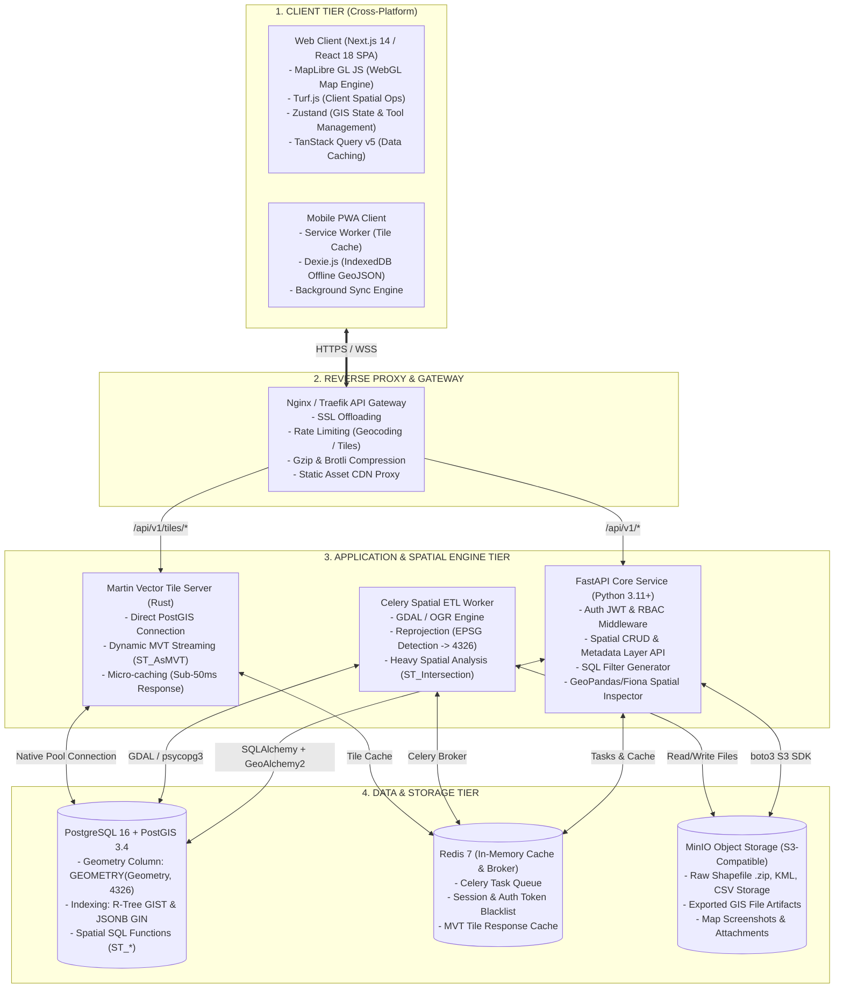
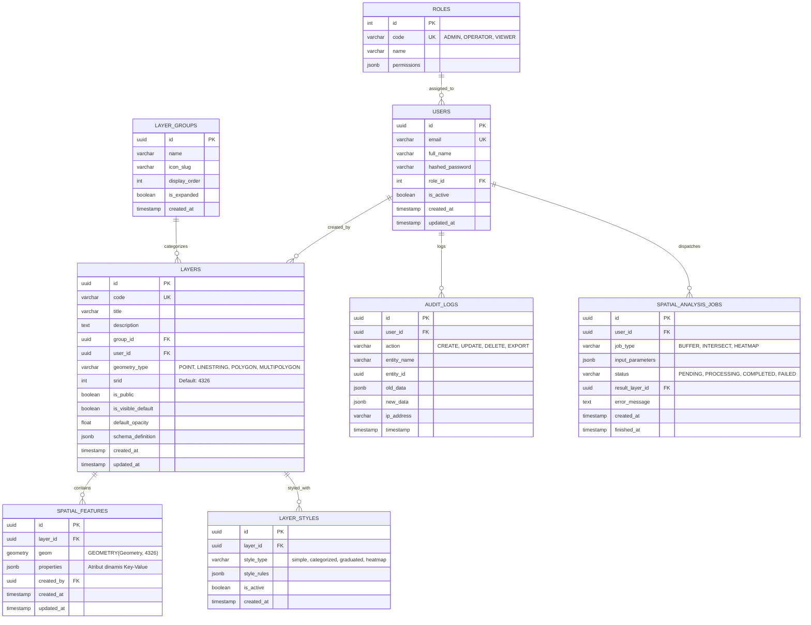
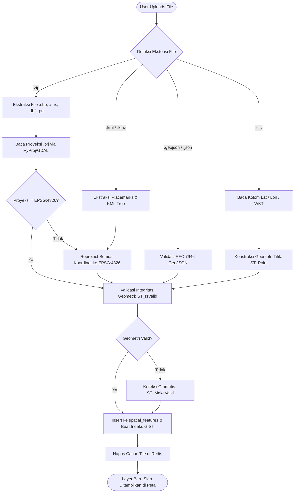
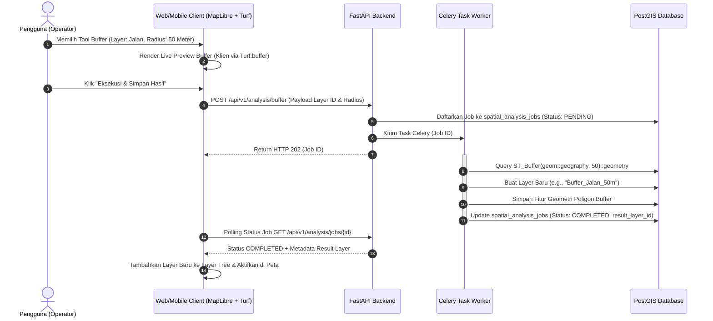
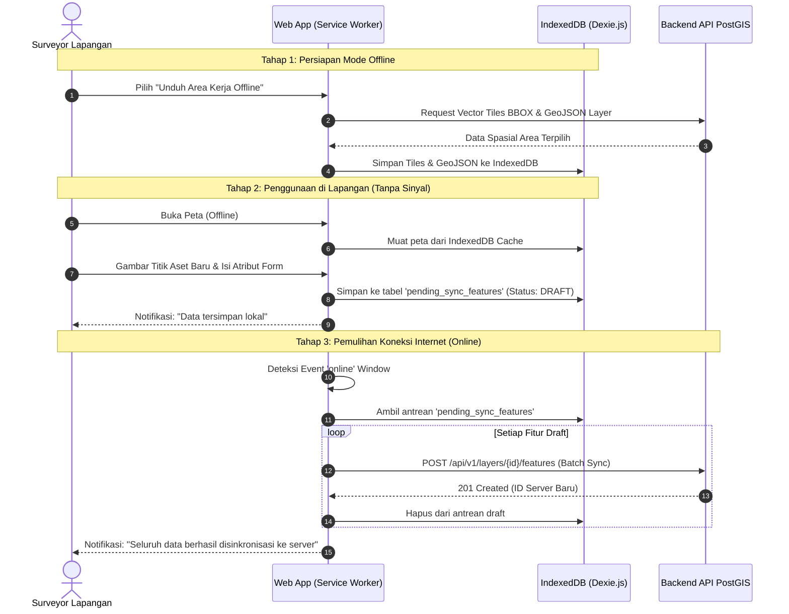

# BLUEPRINT ARSITEKTUR & SPESIFIKASI TEKNIS PENGEMBANG
# HARIS GIS (High-Availability & Responsive Information System - GIS)
**Versi Dokumen:** 1.0.0  
**Target Pembaca:** Lead Architect, Backend Engineer, Frontend Engineer, GIS Specialist, DevOps  
**Status:** Ready for Implementation

---

## 1. ARSITEKTUR SISTEM LENGKAP (C4 ARCHITECTURE MODEL)

HARIS GIS dirancang menggunakan pola **Modular Decoupled GIS Architecture** yang memisahkan antara *Analytical Processing*, *Vector Tile Streaming*, dan *Application Business Logic*.

### 1.1 Diagram Kontainer Sistem (C4 Container Diagram)



### 1.2 Rincian Tanggung Jawab Komponen
1. **Frontend (MapLibre GL JS + React/Next.js)**:
   - Rendering WebGL 60 FPS untuk layer titik, garis, poligon, dan heatmap.
   - Analisis cepat tanpa latensi server menggunakan **Turf.js** (pengukuran jarak, luas poligon, buffer preview).
   - Pengelolaan layer dinamis (toggling, z-ordering, visual opacity slider).
2. **Backend API (FastAPI)**:
   - Kontrak RESTful berkinerja tinggi berbasis asynchronous Python (ASGI).
   - Validasi data otomatis via **Pydantic v2**.
   - Integritas relasional dan audit trail pada setiap operasi CRUD fitur spasial.
3. **Spatial ETL Worker (Celery + GDAL)**:
   - Menghindari *request timeout* saat memproses Shapefile multi-megabyte.
   - Membaca proyeksi dari file `.prj` dan melakukan transformasi koordinat ke WGS84 (`EPSG:4326`).
4. **Vector Tile Server (Martin)**:
   - Mengambil data geometri dari PostGIS langsung dalam format *Mapbox Vector Tile* (`.pbf`/`.mvt`).
   - Mampu melayani ribuan request per detik tanpa membebani runtime Python backend.

---

## 2. REKOMENDASI TEKNOLOGI & ANALISIS TRADE-OFF

### 2.1 Evaluasi Engine Peta Klien

| Parameter | MapLibre GL JS *(Pilihan)* | Leaflet | OpenLayers | Mapbox GL JS v3 |
| :--- | :--- | :--- | :--- | :--- |
| **Lisensi** | BSD 3-Clause (Bebas / Open Source) | BSD 2-Clause (Open Source) | BSD 2-Clause (Open Source) | Proprietary (Berbayar per Map Load) |
| **Teknologi Render** | WebGL 2.0 Hardware Accelerated | HTML5 Canvas / SVG (CPU Heavy) | Canvas & WebGL Hybrid | WebGL 2.0 Hardware Accelerated |
| **Kapasitas Fitur** | >100.000 titik interaktif lancar | <5.000 titik (mulai lag tanpa plugin cluster) | ~50.000 titik | >100.000 titik |
| **Dukungan Vector Tile** | Native (*First-class support*) | Perlu plugin pihak ketiga (`leaflet.vectorgrid`) | Native | Native |
| **3D & Rotasi Peta** | Pitch (0-60°), Bearing/Rotasi 360° | Hanya 2D datar tegak lurus | Dukungan 3D terbatas | Pitch 3D + 3D Terrain Globe |
| **Offline Vector Cache**| Sangat baik (MVT binary via IndexedDB) | Terbatas ke Raster Tiles (ukuran besar) | Memungkinkan | Terbatas oleh lisensi online SDK |

> **Keputusan**: **MapLibre GL JS v4** adalah pilihan mutlak karena performa WebGL modern, dukungan penuh Vector Tile MVT, kemampuan visualisasi 3D/rotasi, bebas lisensi royalti, dan sangat efisien untuk offline cache.

### 2.2 Evaluasi Backend & Engine Spasial

| Kriteria | FastAPI (Python) *(Pilihan)* | NestJS / Express (Node.js) | Go (Golang) |
| :--- | :--- | :--- | :--- |
| **Ekosistem GIS** | **Luar Biasa** (`GDAL`, `GeoPandas`, `Shapely`, `PyProj`) | Terbatas (`@turf/turf`, `shapefile`, `gdal-async`) | Minim (*library GIS masih terfragmentasi*) |
| **Konversi File Kompleks**| Native melalui OGR driver (baca SHP, KML, DGN, GML) | Cenderung *error-prone* pada multi-file SHP | Harus panggil CGO / CLI external |
| **Kecepatan API I/O** | Sangat Cepat (Asyncio uvloop) | Sangat Cepat (Node Event Loop) | Sangat Cepat (Goroutines) |
| **Validasi Skema** | Pydantic v2 (Rust Core, sangat presisi) | class-validator (TypeScript) | Struct tags |

> **Keputusan**: **FastAPI (Python 3.11+)** memberikan keseimbangan terbaik antara kecepatan eksekusi async dan kelengkapan ekosistem manipulasi geospasial OGC kelas dunia.

---

## 3. STRUKTUR BASIS DATA LENGKAP (POSTGIS)

### 3.1 Skema Entity-Relationship (ERD)



### 3.2 Skrip DDL Lengkap dengan Indeks & Trigger

```sql
-- Aktifkan Ekstensi Inti
CREATE EXTENSION IF NOT EXISTS "uuid-ossp";
CREATE EXTENSION IF NOT EXISTS "postgis";
CREATE EXTENSION IF NOT EXISTS "postgis_topology";

-- Trigger Otomatis: Update Kolom updated_at
CREATE OR REPLACE FUNCTION update_timestamp_column()
RETURNS TRIGGER AS $$
BEGIN
    NEW.updated_at = CURRENT_TIMESTAMP;
    RETURN NEW;
END;
$$ LANGUAGE plpgsql;

-- 1. Tabel Peran Pengguna (RBAC)
CREATE TABLE roles (
    id SERIAL PRIMARY KEY,
    code VARCHAR(50) UNIQUE NOT NULL,
    name VARCHAR(100) NOT NULL,
    description TEXT,
    permissions JSONB NOT NULL DEFAULT '{}'
);

INSERT INTO roles (code, name, permissions) VALUES
('ADMIN', 'System Administrator', '{"all": true}'),
('OPERATOR', 'GIS Data Operator', '{"layers:create": true, "layers:update": true, "features:write": true, "analysis:execute": true}'),
('VIEWER', 'Public / Read-only User', '{"layers:read": true, "features:read": true, "analysis:preview": true}');

-- 2. Tabel Pengguna
CREATE TABLE users (
    id UUID PRIMARY KEY DEFAULT uuid_generate_v4(),
    email VARCHAR(255) UNIQUE NOT NULL,
    full_name VARCHAR(150) NOT NULL,
    hashed_password VARCHAR(255) NOT NULL,
    role_id INT NOT NULL REFERENCES roles(id) ON DELETE RESTRICT,
    is_active BOOLEAN NOT NULL DEFAULT TRUE,
    created_at TIMESTAMP WITH TIME ZONE DEFAULT CURRENT_TIMESTAMP,
    updated_at TIMESTAMP WITH TIME ZONE DEFAULT CURRENT_TIMESTAMP
);

CREATE TRIGGER set_users_updated_at
BEFORE UPDATE ON users
FOR EACH ROW EXECUTE FUNCTION update_timestamp_column();

-- 3. Tabel Grup Layer
CREATE TABLE layer_groups (
    id UUID PRIMARY KEY DEFAULT uuid_generate_v4(),
    name VARCHAR(120) NOT NULL,
    icon_slug VARCHAR(50) DEFAULT 'folder',
    display_order INT NOT NULL DEFAULT 0,
    is_expanded BOOLEAN NOT NULL DEFAULT TRUE,
    created_at TIMESTAMP WITH TIME ZONE DEFAULT CURRENT_TIMESTAMP
);

-- 4. Tabel Metadata Layer
CREATE TABLE layers (
    id UUID PRIMARY KEY DEFAULT uuid_generate_v4(),
    code VARCHAR(100) UNIQUE NOT NULL,
    title VARCHAR(200) NOT NULL,
    description TEXT,
    group_id UUID REFERENCES layer_groups(id) ON DELETE SET NULL,
    user_id UUID REFERENCES users(id) ON DELETE SET NULL,
    geometry_type VARCHAR(50) NOT NULL,
    srid INT NOT NULL DEFAULT 4326,
    is_public BOOLEAN NOT NULL DEFAULT FALSE,
    is_visible_default BOOLEAN NOT NULL DEFAULT TRUE,
    default_opacity FLOAT NOT NULL DEFAULT 1.0 CHECK (default_opacity >= 0.0 AND default_opacity <= 1.0),
    schema_definition JSONB NOT NULL DEFAULT '[]', -- Contoh: [{"field": "kategori", "type": "string", "label": "Kategori"}]
    created_at TIMESTAMP WITH TIME ZONE DEFAULT CURRENT_TIMESTAMP,
    updated_at TIMESTAMP WITH TIME ZONE DEFAULT CURRENT_TIMESTAMP
);

CREATE TRIGGER set_layers_updated_at
BEFORE UPDATE ON layers
FOR EACH ROW EXECUTE FUNCTION update_timestamp_column();

-- 5. Tabel Fitur Spasial
CREATE TABLE spatial_features (
    id UUID PRIMARY KEY DEFAULT uuid_generate_v4(),
    layer_id UUID NOT NULL REFERENCES layers(id) ON DELETE CASCADE,
    geom GEOMETRY(Geometry, 4326) NOT NULL,
    properties JSONB NOT NULL DEFAULT '{}',
    created_by UUID REFERENCES users(id) ON DELETE SET NULL,
    created_at TIMESTAMP WITH TIME ZONE DEFAULT CURRENT_TIMESTAMP,
    updated_at TIMESTAMP WITH TIME ZONE DEFAULT CURRENT_TIMESTAMP
);

CREATE TRIGGER set_spatial_features_updated_at
BEFORE UPDATE ON spatial_features
FOR EACH ROW EXECUTE FUNCTION update_timestamp_column();

-- INDEKS SPASIAL & JSONB (OPTIMASI QUERY)
CREATE INDEX idx_spatial_features_geom ON spatial_features USING GIST (geom);
CREATE INDEX idx_spatial_features_layer_id ON spatial_features (layer_id);
CREATE INDEX idx_spatial_features_props ON spatial_features USING GIN (properties);

-- 6. Tabel Gaya / Simbologi Layer
CREATE TABLE layer_styles (
    id UUID PRIMARY KEY DEFAULT uuid_generate_v4(),
    layer_id UUID NOT NULL REFERENCES layers(id) ON DELETE CASCADE,
    style_type VARCHAR(50) NOT NULL DEFAULT 'simple',
    style_rules JSONB NOT NULL,
    is_active BOOLEAN NOT NULL DEFAULT TRUE,
    created_at TIMESTAMP WITH TIME ZONE DEFAULT CURRENT_TIMESTAMP
);

-- 7. Tabel Antrean Pekerjaan Analisis Spasial
CREATE TABLE spatial_analysis_jobs (
    id UUID PRIMARY KEY DEFAULT uuid_generate_v4(),
    user_id UUID REFERENCES users(id) ON DELETE SET NULL,
    job_type VARCHAR(50) NOT NULL, -- BUFFER, INTERSECT, HEATMAP
    input_parameters JSONB NOT NULL,
    status VARCHAR(30) NOT NULL DEFAULT 'PENDING',
    result_layer_id UUID REFERENCES layers(id) ON DELETE SET NULL,
    error_message TEXT,
    created_at TIMESTAMP WITH TIME ZONE DEFAULT CURRENT_TIMESTAMP,
    finished_at TIMESTAMP WITH TIME ZONE
);

-- 8. Tabel Audit Log
CREATE TABLE audit_logs (
    id UUID PRIMARY KEY DEFAULT uuid_generate_v4(),
    user_id UUID REFERENCES users(id) ON DELETE SET NULL,
    action VARCHAR(50) NOT NULL,
    entity_name VARCHAR(100) NOT NULL,
    entity_id UUID,
    old_data JSONB,
    new_data JSONB,
    ip_address VARCHAR(45),
    timestamp TIMESTAMP WITH TIME ZONE DEFAULT CURRENT_TIMESTAMP
);
CREATE INDEX idx_audit_logs_user_id ON audit_logs (user_id);
CREATE INDEX idx_audit_logs_timestamp ON audit_logs (timestamp);
```

---

## 4. FLOW FITUR UTAMA & DIAGRAM ALUR

### 4.1 Alur Upload & Konversi Data Spasial (Shapefile, GeoJSON, KML, CSV)



### 4.2 Alur Analisis Spasial (Buffer & Intersect)



### 4.3 Alur Offline Caching & Background Sync (Mobile PWA)



---

## 5. WIREFRAME UI/UX HALAMAN PENTING

### 5.1 Halaman Utama Desktop (Split-Panel GIS Workspace)

```
+=============================================================================================================================+
| [HARIS GIS]  | [Q Cari alamat, fasilitas, atau koordinat (-6.20, 106.81)...]           | [Basemap v] [Analisis v] | [User Admin v] |
+=============================================================================================================================+
| [LAYER TREE]           | [TOOLBAR PETA: (Pointer) (Titik) (Garis) (Poligon) (Ukur Jarak) (Buffer) (Hapus) (Undo)]   | [INSPEKTOR FITUR]  |
| ---------------------- +---------------------------------------------------------------------------------------------+ ------------------ |
| [+] Tambah Layer Baru  |                                                                                             | ID: FT-88291       |
|                        |                                                                                             | Layer: Titik RS    |
| [v] Kategori Aset Kota |                                  MAP CANVAS (MapLibre GL)                                   | ------------------ |
|   [*] Jaringan Jalan   |                                                                                             | Nama: RSUD Haris   |
|       Opacity: [====]  |                             [Polygon Area: 4.2 Ha]                                          | Kapasitas: 240 Bed |
|   [*] RS & Puskesmas   |                                                                                             | Status: Aktif      |
|       Opacity: [======]|                          (o) Titik Terpilih                                                 |                    |
|                        |                                                                                             | [Edit Geometri]    |
| [v] Batas Administrasi |                                                                                             | [Update Atribut]   |
|   [ ] Batas Desa/Kel   |                                                                                             | [Hapus Fitur]      |
|                        |                                                                                             |                    |
|                        |                                                                                             | ------------------ |
| ---------------------- |                                                                                             | [LEGENDA PETA]     |
| [Buka Tabel Atribut]   |                                                                                             | [*] Rumah Sakit    |
| [Buka Dashboard Stats] | [Skala Dinamis 1:25.000]  |  [Koordinat: 106.84513° E, -6.20876° S | UTM 48S 704812 9313200]  | [=] Jalan Kolektor |
+------------------------+---------------------------------------------------------------------------------------------+--------------------+
| [v] TABEL ATRIBUT: Layer Jaringan Jalan (Menampilkan 45 dari 312 Fitur dalam Tampilan Peta)           [Filter Extent: ON]  [Ekspor Data v] |
| +-----------------------------------------------------------------------------------------------------------------------------------------+ |
| | ID      | Nama Ruas Jalan            | Tipe Jalan   | Panjang (Km) | Kondisi Fisik | Terakhir Diperbarui | Aksi                          | |
| |---------|----------------------------|--------------|--------------|---------------|---------------------|-------------------------------| |
| | JL-001  | Jl. Sudirman Poros Utama   | Arteri Primer| 4.25         | Baik          | 2026-10-12 14:20    | [Zoom] [Edit] [Hapus]         | |
| | JL-002  | Jl. Thamrin Lingkar Luar   | Kolektor     | 2.10         | Sedang        | 2026-10-15 09:12    | [Zoom] [Edit] [Hapus]         | |
| +-----------------------------------------------------------------------------------------------------------------------------------------+ |
+=============================================================================================================================+
```

### 5.2 Halaman Tampilan Mobile Responsif (PWA Mobile View)

```
+-----------------------------------+
| [=] HARIS GIS     [Q Cari]   (GPS)|
+-----------------------------------+
|                                   |
|                                   |
|            MAP VIEWPORT           |
|                                   |
|                                   |
|             (o) Lokasi            |
|                                   |
|                                   |
|                         [+] Zoom  |
|                         [-] In/Out|
|                                   |
|                         (Layer)   |
|                         (Tambah)  |
+-----------------------------------+
| ^ BOTTOM SHEET (Geser ke atas)    |
| ================================= |
| Puskesmas Menteng                 |
| Kategori: Fasilitas Kesehatan     |
| Jarak: 320m dari posisi Anda      |
|                                   |
| [Navigasi Rute]  [Edit Data]      |
+-----------------------------------+
```

### 5.3 Modal Wizard Upload & Konversi Data Spasial

```
+------------------------------------------------------------------+
| Unggah & Konversi Data Spasial                               [X] |
+------------------------------------------------------------------+
| Langkah 1 dari 3: Pilih Berkas                                   |
|                                                                  |
| +--------------------------------------------------------------+ |
| |                  [ ICON CLOUD UPLOAD ]                       | |
| |   Seret & Lepas file spasial Anda di sini (Max: 100MB)       | |
| |   Mendukung: .ZIP (Shapefile), .GeoJSON, .KML, .CSV          | |
| |                     [Pilih Berkas...]                        | |
| +--------------------------------------------------------------+ |
| File terpilih: batas_kecamatan_2026.zip (14.2 MB)                |
|                                                                  |
| Pengaturan Parameter:                                            |
| Nama Layer : [Batas Kecamatan 2026____________________________]  |
| Kategori   : [Batas Administrasi                           v]  |
| Proyeksi   : [Otomatis dari .prj (Terdeteksi EPSG:32748)   v]  |
|                                                                  |
| [ ] Publikasikan ke Pengguna Tamu (Public Layer)                 |
|                                                                  |
|                                          [Batal]  [Proses Ingest]|
+------------------------------------------------------------------+
```

### 5.4 Modal Wizard Analisis Spasial (Buffer & Intersect)

```
+------------------------------------------------------------------+
| Analisis Spasial Cepat                                       [X] |
+------------------------------------------------------------------+
| Tipe Analisis: (o) Buffer Zone       ( ) Spatial Intersect       |
| ---------------------------------------------------------------- |
| 1. Pilih Layer Sumber : [Jaringan Sungai Utama                v] |
| 2. Radius Buffer      : [ 100 ] Meter                            |
| 3. Satuan Jarak       : [ Meter                               v] |
| 4. Opsi Penyambungan  : [x] Dissolve Hasil Buffer (Gabung Poligon)|
|                                                                  |
| Pratinjau Klien:                                                 |
| +--------------------------------------------------------------+ |
| | [ Peta Mini: Menampilkan Poligon Buffer Biru Transparan ]    | |
| +--------------------------------------------------------------+ |
| Simpan Sebagai Layer Baru:                                       |
| Judul Layer Hasil: [Kawasan Lindung Sempadan Sungai 100m______]  |
|                                                                  |
|                                        [Batal]  [Eksekusi & Simpan]|
+------------------------------------------------------------------+
```

---

## 6. SPESIFIKASI API ENDPOINT GIS (DENGAN CONTOH REQUEST & RESPONSE)

### 6.1 Upload & Konversi Data Spasial
- **Endpoint**: `POST /api/v1/spatial/upload`
- **Content-Type**: `multipart/form-data`
- **Request Headers**: `Authorization: Bearer <jwt_token>`
- **Form Data**:
  - `file`: `<binary file stream>`
  - `layer_title`: `"Batas Administrasi 2026"`
  - `group_id`: `"7c9e6679-7425-40de-944b-e07fc1f90ae7"`
  - `is_public`: `false`

**Contoh Response (HTTP 202 Accepted):**
```json
{
  "success": true,
  "message": "File diterima dan sedang diproses dalam antrean",
  "data": {
    "task_id": "a1b2c3d4-e5f6-7a8b-9c0d-1e2f3a4b5c6d",
    "filename": "batas_administrasi_2026.zip",
    "detected_format": "SHAPEFILE",
    "status": "PROCESSING",
    "check_status_url": "/api/v1/spatial/tasks/a1b2c3d4-e5f6-7a8b-9c0d-1e2f3a4b5c6d"
  }
}
```

---

### 6.2 Polling Status Pekerjaan Konversi Spasial
- **Endpoint**: `GET /api/v1/spatial/tasks/{task_id}`

**Contoh Response (HTTP 200 OK - Selesai):**
```json
{
  "task_id": "a1b2c3d4-e5f6-7a8b-9c0d-1e2f3a4b5c6d",
  "status": "COMPLETED",
  "progress_percent": 100,
  "result": {
    "layer_id": "4b92b678-2cf1-45bc-98de-4a0eb1b4d001",
    "layer_code": "layer_batas_administrasi_2026",
    "total_features": 44,
    "geometry_type": "MultiPolygon",
    "detected_srid": 32748,
    "transformed_to_srid": 4326,
    "detected_fields": [
      {"name": "KODE_KEC", "type": "string"},
      {"name": "NAMA_KEC", "type": "string"},
      {"name": "LUAS_HA", "type": "float"}
    ]
  }
}
```

---

### 6.3 Query Fitur Spasial Berbasis Bounding Box (BBOX) & Pagination
- **Endpoint**: `GET /api/v1/layers/{layer_id}/features?bbox=106.80,-6.25,106.85,-6.20&page=1&page_size=10`
- **Tujuan**: Mengambil GeoJSON FeatureCollection untuk viewport peta saat ini.

**Contoh Response (HTTP 200 OK):**
```json
{
  "type": "FeatureCollection",
  "totalFeatures": 1,
  "page": 1,
  "pageSize": 10,
  "features": [
    {
      "type": "Feature",
      "id": "e3b0c442-98fc-1c14-9afb-4c7fa37053e1",
      "geometry": {
        "type": "Point",
        "coordinates": [106.827153, -6.220192]
      },
      "properties": {
        "nama": "Puskesmas Kebayoran",
        "kategori": "Fasilitas Kesehatan",
        "kapasitas": 50,
        "alamat": "Jl. Senopati No. 12"
      }
    }
  ]
}
```

---

### 6.4 Analisis Spasial: Buffer Layer
- **Endpoint**: `POST /api/v1/analysis/buffer`
- **Request Body:**
```json
{
  "source_layer_id": "4b92b678-2cf1-45bc-98de-4a0eb1b4d001",
  "buffer_distance": 500,
  "distance_unit": "meters",
  "dissolve": true,
  "output_layer_title": "Buffer Fasilitas Kesehatan 500m"
}
```

**Contoh Response (HTTP 201 Created):**
```json
{
  "success": true,
  "message": "Analisis buffer selesai dan disimpan sebagai layer baru",
  "data": {
    "result_layer_id": "8f309a12-612b-4221-8711-209cbafe1234",
    "title": "Buffer Fasilitas Kesehatan 500m",
    "geometry_type": "MultiPolygon",
    "feature_count": 1,
    "calculated_total_area_ha": 78.54
  }
}
```

---

### 6.5 Geocoding (Pencarian Alamat & Koordinat)
- **Endpoint**: `GET /api/v1/geo/search?q=Monas+Jakarta`

**Contoh Response (HTTP 200 OK):**
```json
{
  "query": "Monas Jakarta",
  "results": [
    {
      "display_name": "Monumen Nasional, Gambir, Jakarta Pusat, DKI Jakarta, Indonesia",
      "latitude": -6.175392,
      "longitude": 106.827153,
      "bounding_box": [106.824, -6.177, 106.830, -6.173],
      "type": "attraction",
      "importance": 0.82
    }
  ]
}
```

---

## 7. RENCANA PENGEMBANGAN BERTAHAP (ROADMAP IMPLEMENTASI)

```
+--------------------------------------------------------------------------------------------------+
| FASE 1: MVP FONDASI & VIEWER (Bulan 1 - 2)                                                       |
| Target: Peta interaktif dapat diakses, auth RBAC bekerja, dan layer dasar dapat ditampilkan.     |
+--------------------------------------------------------------------------------------------------+
| - Sprint 1: Setup Infrastructure (Docker Compose PostGIS, Martin, Redis, MinIO).                 |
| - Sprint 2: Core Auth & RBAC (JWT, Users, Roles: Admin, Operator, Viewer).                       |
| - Sprint 3: Map Viewport (MapLibre GL JS, Basemap Switcher OSM/Google/Satellite, Zoom/Pan).     |
| - Sprint 4: Dynamic Layer Tree & Opacity Control (Toggle On/Off, Slider Transparansi).           |
+--------------------------------------------------------------------------------------------------+
                                                |
                                                v
+--------------------------------------------------------------------------------------------------+
| FASE 2: SPATIAL ETL & MANAJEMEN ATRIBUT (Bulan 3 - 4)                                            |
| Target: Operator dapat mengunggah file GIS, mengedit fitur langsung di peta, dan filter data.   |
+--------------------------------------------------------------------------------------------------+
| - Sprint 5: Asynchronous Spatial ETL (Upload SHP .zip, GeoJSON, KML, CSV -> Reproject ke 4326). |
| - Sprint 6: Vector Tile Streaming (Martin MVT Integration for high-performance rendering).       |
| - Sprint 7: Dynamic Attribute Table (DataGrid dengan Filter BBOX Extent Peta & Sorting).         |
| - Sprint 8: Feature Geometry & Attribute CRUD (Draw Polygon, Line, Point + Edit Form).           |
+--------------------------------------------------------------------------------------------------+
                                                |
                                                v
+--------------------------------------------------------------------------------------------------+
| FASE 3: ANALISIS KERUANGAN & STATISTIK (Bulan 5 - 6)                                             |
| Target: Analisis buffer & intersect presisi, geocoding, dan visualisasi statistik analitik.     |
+--------------------------------------------------------------------------------------------------+
| - Sprint 9: Spatial Measurement & Geocoding (Turf Measure Jarak/Luas, Nominatim Forward/Reverse).|
| - Sprint 10: Server-side Buffer & Intersect Analysis (PostGIS ST_Buffer & ST_Intersection).      |
| - Sprint 11: Real-time Heatmap Layer (WebGL Shader Density Marker).                              |
| - Sprint 12: Map-Linked Statistical Dashboard (Chart Recharts/Chart.js bereaksi terhadap BBOX).  |
+--------------------------------------------------------------------------------------------------+
                                                |
                                                v
+--------------------------------------------------------------------------------------------------+
| FASE 4: MOBILE OFFLINE PWA & ENTERPRISE HARDENING (Bulan 7 - 8)                                  |
| Target: Penggunaan offline di lapangan, sinkronisasi otomatis, audit log, dan keamanan penuh.    |
+--------------------------------------------------------------------------------------------------+
| - Sprint 13: PWA Service Worker Tile Caching & IndexedDB (Dexie.js) Data Storage.                |
| - Sprint 14: Mobile Responsive UI & Field Surveyor Mode (Bottom Sheet & Offline Draft Sync).    |
| - Sprint 15: Security Hardening (Spatial Injection Prevention, Rate Limiter, Audit Trail Logs).   |
| - Sprint 16: Load Testing, Dokumentasi Pengembang Final & Deployment Production.                 |
+--------------------------------------------------------------------------------------------------+
```

---

## 8. STRUKTUR PROYEK REKOMENDASI (MONOREPO / DECOUPLED)

```
haris-gis/
├── .env.example
├── docker-compose.yml
├── docker/
│   └── init-db/
│       └── 01-init.sql
├── docs/
│   ├── HARIS_GIS_TECHNICAL_SPECIFICATION.md
│   ├── types.ts                     # TypeScript GIS Contract
│   └── schemas.py                   # Pydantic Schema Definitions
├── backend/                         # FastAPI Python Backend
│   ├── Dockerfile
│   ├── pyproject.toml
│   └── app/
│       ├── main.py
│       ├── core/                    # Config, Security, DB Engine
│       ├── models/                  # SQLAlchemy / GeoAlchemy2 Models
│       ├── schemas/                 # Pydantic Validation Schemas
│       ├── api/v1/                  # Endpoints (auth, layers, features, analysis)
│       └── workers/                 # Celery Tasks (GDAL File Ingestion)
├── frontend/                        # Next.js 14 / Vite React Frontend
│   ├── Dockerfile
│   ├── package.json
│   └── src/
│       ├── components/
│       │   ├── map/                 # MapLibre Canvas, Controls, Popups
│       │   ├── layers/              # LayerTree, OpacitySlider, Symbology
│       │   ├── analysis/            # BufferDialog, MeasureTool, Heatmap
│       │   └── datatable/           # AttributeGrid, ExtentFilter
│       ├── hooks/                   # useMapInstance, useGeolocation
│       ├── stores/                  # Zustand (mapStore, layerStore)
│       └── service-worker/          # Workbox & Dexie Offline Sync
```
